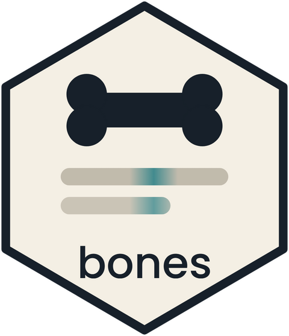

<a href="https://tenmeh.github.io">
  <picture>
    <source media="(prefers-color-scheme: dark)" srcset="assets/banner-dark.svg">
    
  </picture>
</a>

  
  &nbsp;
  
  &nbsp;
  

Hi, I'm Tanmay. I make R packages. I write about how I build them on
[my blog](https://tenmeh.github.io). You can also find me on
[LinkedIn](https://www.linkedin.com/in/tanmay-chanda/).

### Packages

<a href="https://github.com/tenmeh/rewind">
  <picture>
    <source media="(prefers-color-scheme: dark)" srcset="assets/cards/rewind-dark.svg">
    
  </picture>
</a>
<a href="https://github.com/tenmeh/bones">
  <picture>
    <source media="(prefers-color-scheme: dark)" srcset="assets/cards/bones-dark.svg">
    
  </picture>
</a>
<a href="https://github.com/tenmeh/whence">
  <picture>
    <source media="(prefers-color-scheme: dark)" srcset="assets/cards/whence-dark.svg">
    
  </picture>
</a>
<a href="https://github.com/tenmeh/tanmai-r">
  <picture>
    <source media="(prefers-color-scheme: dark)" srcset="assets/cards/tanmai-r-dark.svg">
    
  </picture>
</a>
<a href="https://github.com/tenmeh/tanmai">
  <picture>
    <source media="(prefers-color-scheme: dark)" srcset="assets/cards/tanmai-dark.svg">
    
  </picture>
</a>

<picture>
  <source media="(prefers-color-scheme: dark)" srcset="assets/stats-dark.svg">
  
</picture>
<picture>
  <source media="(prefers-color-scheme: dark)" srcset="assets/languages-dark.svg">
  
</picture>

### Latest from the blog

<!-- BLOG:START -->
- [Where did this number come from?](https://tenmeh.github.io/posts/2026-10-25-whence-on-cran/) 25 Oct 2026
- [Recording Shiny demos frame by frame](https://tenmeh.github.io/posts/2026-10-13-recording-shiny-demos/) 13 Oct 2026
- [rewind 0.3.0: show what changed](https://tenmeh.github.io/posts/2026-10-02-rewind-0-3-0/) 02 Oct 2026
- [A spinner says wait. A skeleton says what is coming.](https://tenmeh.github.io/posts/2026-09-28-how-bones-began/) 28 Sep 2026
<!-- BLOG:END -->

<picture>
  <source media="(prefers-color-scheme: dark)" srcset="https://raw.githubusercontent.com/tenmeh/tenmeh/output/snake-dark.svg">
  
</picture>
